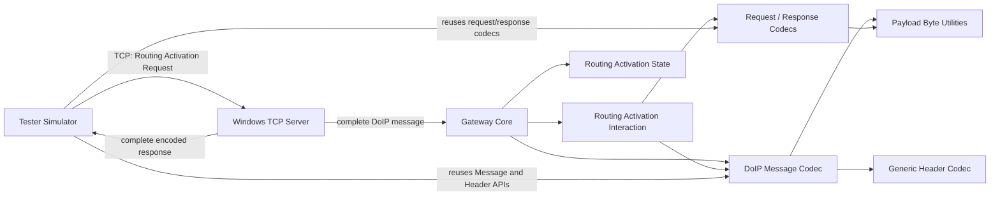

# mini-doip-gateway

A lightweight C99 learning and demonstration project for a DoIP Routing Activation Gateway.

The project explores Automotive Ethernet and mechanisms defined by ISO 13400, including DoIP Generic Header and payload encoding, TCP stream framing, Routing Activation request/response handling, and gateway state management. It includes a Windows Winsock TCP Server, a Tester Simulator, unit tests, and TCP integration tests.

This is an educational implementation, not a complete ISO 13400 implementation or a certified product.

## Architecture



- **Tester Simulator** constructs a Routing Activation Request, sends it over TCP, and validates the returned DoIP response.
- **TCP Server** accepts one client at a time. It reads the fixed 8-byte Generic Header first, checks the declared Payload Length against its configured local limit, receives the entire payload, then passes one complete DoIP message to Gateway Core. It sends the complete encoded response using a send loop.
- **Gateway Core** decodes and validates the complete message, accepts Routing Activation Request as its supported request type, consults the Routing Activation State module, and constructs a response.
- **Routing Activation Interaction and codecs** encode/decode the basic request and response payload forms.
- **Routing Activation State** manages one simplified logical-client context.
- **DoIP Message, Generic Header, and Payload modules** provide message framing, explicit Header encoding/decoding, and bounded byte-copy functionality.

## Features

- C99 DoIP Generic Header encoding and decoding, including validation of the project's currently supported protocol version (`0x02`) and inverse (`0xFD`).
- Basic Routing Activation Request (7-byte payload) and Response (9-byte payload) encoding and decoding.
- Gateway processing of complete Routing Activation Request messages and generation of complete Routing Activation Response messages.
- A minimal Routing Activation state model: the first request activates the context; a repeated request from the same logical address is treated as successful; a different logical address receives the configured conflict Response Code without replacing the active address.
- A Windows Winsock TCP Server with a single-client service loop, bounded payload buffering, TCP short-read handling, and complete-send handling.
- A Windows Tester Simulator that validates the response Header, Payload Type, Payload Length, Response Body, client/entity logical addresses, and Response Code. It reports success only for Response Code `0x10` and matching logical addresses.
- The Tester uses a 3-second connection timeout and a 5-second total deadline for its send operation and for each exact-read stage (response Header and response Payload).
- Unit tests for Header, Message, Payload, Gateway, and Routing Activation modules, plus Windows TCP Server and Tester integration tests.

The TCP Server's 4096-byte maximum payload and the Tester's corresponding receive limit are local implementation safety limits, not a claim about the general maximum defined by the DoIP standard.

## Build and Test

The project uses CMake and requires a C99 compiler. On Windows, the TCP Server, Tester, and their socket integration tests use Winsock (`ws2_32`). The CMake configuration only adds those transport-specific targets on Windows; the protocol core and its portable unit tests are separate from the Winsock targets. A Windows C compiler and CMake generator supported by that compiler must be available.

From PowerShell at the repository root:

```powershell
cmake -S . -B build
cmake --build build
ctest --test-dir build -V
```

The `ctest` command runs the tests registered by the configured platform build. On Windows this includes the TCP Server and Tester network tests; on other platforms, the Windows-only targets are not configured.

## End-to-End Demo

The Windows executables are built under `build\c-core`.

Open two PowerShell terminals in the repository root. In terminal A, start the server:

```powershell
.\build\c-core\doip_tcp_server.exe 127.0.0.1 13400
```

The server binds to the provided IPv4 address and port and prints its listening endpoint. Press **Ctrl+C** in terminal A to stop it.

In terminal B, run the Tester:

```powershell
.\build\c-core\doip_tester.exe 127.0.0.1 13400 0x0E00 0x1000
```

The arguments are server IPv4 address, TCP port, Tester Logical Address, and expected DoIP Entity Logical Address. The Tester sends a basic Routing Activation Request and reports success only after receiving and validating a Routing Activation Response with matching logical addresses and Response Code `0x10`. Connection failures, malformed or incomplete responses, mismatched addresses, and non-success Response Codes result in a failure exit status.

To run the same local demonstration with managed startup and cleanup, use the Windows PowerShell helper:

```powershell
.\scripts\demo-doip.ps1
```

It defaults to `127.0.0.1:13400`. Use `-ServerAddress` and `-Port` to select another endpoint. The script requires both `doip_tcp_server.exe` and `doip_tester.exe` in `build\c-core`; build first using the commands above.

## Protocol Scope and Limitations

### Implemented

- Generic Header and the basic Routing Activation payload forms described above.
- A complete-message Gateway path for Routing Activation Request and Response.
- A Windows single-client TCP demonstration path and a Tester for that exchange.

### Simplifications

- The state manager holds one logical client context, not a multi-connection state table.
- The first Routing Activation Request is accepted by the project's simplified state policy; activation type and broader authorization/business policy are not fully evaluated.
- The server configures `0x03` as its conflict Response Code, while the state module leaves that policy value explicit. This is a project configuration, not a claim that the value is universally correct for every standards-defined conflict case.
- The implementation currently accepts only Header version `0x02` with inverse `0xFD`.
- The basic request and response forms do not include OEM-specific extension data.
- The TCP Server and Tester use a local 4096-byte payload bound.

### Not implemented

- A complete ISO 13400 state machine, every standardized response code, or official conformance/certification.
- Multiple simultaneous TCP clients or concurrent connection handling.
- UDP Vehicle Identification, Alive Check, Diagnostic Message handling, or end-to-end diagnostic forwarding.
- Integration with a real vehicle-side ECU or network.
- OEM-specific extension data.
- A POSIX/Linux TCP Server implementation; the current TCP Server and Tester use Windows Winsock.

## Repository Structure

```text
.
├── CMakeLists.txt
├── README.md
├── scripts/
│   └── demo-doip.ps1
└── c-core/
    ├── CMakeLists.txt
    ├── include/
    │   ├── doip_gateway.h
    │   ├── doip_header.h
    │   ├── doip_message.h
    │   ├── doip_payload.h
    │   ├── doip_payload_type.h
    │   ├── doip_routing_activation.h
    │   ├── doip_routing_activation_request.h
    │   ├── doip_routing_activation_response.h
    │   ├── doip_routing_activation_state.h
    │   ├── doip_tcp_server.h
    │   └── doip_tester.h
    ├── src/
    │   ├── doip_gateway.c
    │   ├── doip_header.c
    │   ├── doip_message.c
    │   ├── doip_payload.c
    │   ├── doip_routing_activation.c
    │   ├── doip_routing_activation_request.c
    │   ├── doip_routing_activation_response.c
    │   ├── doip_routing_activation_state.c
    │   ├── doip_tcp_server.c
    │   ├── doip_tcp_server_main.c
    │   ├── doip_tester.c
    │   └── doip_tester_main.c
    └── tests/
        ├── CMakeLists.txt
        ├── test_doip_gateway.c
        ├── test_doip_header.c
        ├── test_doip_message.c
        ├── test_doip_payload.c
        ├── test_doip_routing_activation.c
        ├── test_doip_routing_activation_request.c
        ├── test_doip_routing_activation_response.c
        ├── test_doip_routing_activation_state.c
        ├── test_doip_tcp_server.c
        └── test_doip_tester.c
```

The TCP Server and Tester source files are included in Windows builds. Their tests are likewise registered only when configuring on Windows.

## Future Work

Potential future work, not included in the current implementation:

- Broader protocol boundary and malformed-message tests.
- Diagnostic Message processing and forwarding.
- More precise protocol error classification.
- A Linux/POSIX TCP Server adaptation.
- Continuous Integration builds and tests across supported compilers/platforms.
