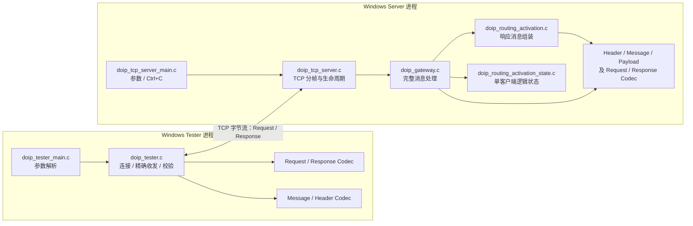

# 01 系统架构

## 学习目标

理解协议核心与 Windows 传输层的边界，能从实际文件和结构体解释依赖方向、数据传递方式及架构适用范围。

## 架构图

下图只显示源码中存在的模块和调用依赖。Tester 进程与 Server 进程分别运行；两者通过 TCP 交换完整编码消息。Gateway 与 Routing Activation State 在 Server 进程的 `doip_tcp_server_t` 中持有。

`doip_payload_type.h` 只提供常量，不是一个独立的解析器。ECU、UDP Discovery、诊断转发和 OEM 扩展处理模块不存在于当前源码中。

## Protocol Core 与 Transport Layer

### Protocol Core

协议核心文件不创建 socket。主要职责是把内存中的字段与线上字节相互转换，并对完整消息和简化状态做检查：

- `doip_types.h`：统一 `doip_result_t` 错误枚举。
- `doip_header.c`：编码/解码 Generic Header。
- `doip_payload.c`：载荷长度检查与逐字节拷贝。
- `doip_message.c`：将 Header 与 Payload Body 组合成完整消息，或返回借用输入内存的消息视图。
- `doip_routing_activation_request.c` / `doip_routing_activation_response.c`：解析与生成固定长度基本载荷。
- `doip_routing_activation.c`：生成 Routing Activation Response 完整消息；另提供从原始 Request 消息直接生成响应的便捷入口。
- `doip_routing_activation_state.c`：一份简化状态上下文。
- `doip_gateway.c`：对完整输入消息做类型分发、状态决策并调用响应组装模块。

### Windows TCP Transport

- `doip_tcp_server.c` 拥有 Winsock 初始化、listen/client socket、连接接受、Generic Header 先行读取、Payload Length 上限、精确接收、完整发送、连接关闭及状态重置。
- `doip_tester.c` 拥有客户端 socket、连接超时、请求发送、响应 Header/Body 接收与校验。
- `doip_tcp_server_main.c` 和 `doip_tester_main.c` 负责命令行和进程入口。

Server 的网络模块将完整编码报文交给 Gateway；Gateway 不知道 socket 或 TCP 分段。反向方向上，Gateway 返回完整编码的响应，由 Server 负责 `send()` 循环。

## 主要源文件职责

| 文件 | 责任与关键入口 |
|---|---|
| `c-core/src/doip_header.c` | `doip_header_encode/decode`：8 字节 Header 的大端序字段处理，限制版本为项目常量。 |
| `c-core/src/doip_payload.c` | `doip_payload_check_length` 比较长度；`doip_payload_copy` 在容量检查后逐字节复制。 |
| `c-core/src/doip_message.c` | `doip_message_encode` 组合完整消息；`doip_message_decode` 解码一个且仅一个消息并借用 Payload 指针。 |
| `c-core/src/doip_routing_activation_request.c` | Request Body 7 字节编码/解码；Reserved 字节必须为零。 |
| `c-core/src/doip_routing_activation_response.c` | Response Body 9 字节编码/解码；保留 Response Code 值，Reserved 字节必须为零。 |
| `c-core/src/doip_routing_activation_state.c` | reset、首次激活、同地址重复成功、不同地址冲突、读取状态。 |
| `c-core/src/doip_routing_activation.c` | 组装 9 字节响应 Body、Response Header 和完整响应消息；便捷入口解析 Request 后委托组装。 |
| `c-core/src/doip_gateway.c` | 验证完整消息、只接受 Request Payload Type、检查响应容量、更新状态并生成完整响应。 |
| `c-core/src/doip_tcp_server.c` | Windows TCP 服务端及非阻塞 I/O 辅助函数。 |
| `c-core/src/doip_tcp_server_main.c` | Server 默认参数、参数解析、控制台停止处理器。 |
| `c-core/src/doip_tester.c` | Windows Tester 的 TCP 客户端实现和响应验证。 |
| `c-core/src/doip_tester_main.c` | Tester 参数解析及退出码映射。 |

## 主要结构体

| 结构体 | 成员用途 |
|---|---|
| `doip_header_t` | `protocol_version`、`inverse_protocol_version`、`payload_type`、`payload_length` 的主机内存表示；不是可直接 `memcpy` 上线的 Wire Header。 |
| `doip_message_view_t` | 包含已解码的 `header` 及指向输入缓冲区的 `payload` 指针；不拥有或复制 Payload。 |
| `doip_routing_activation_request_t` | `source_address` 与 `activation_type`；7 字节载荷中 Reserved 字段没有对应结构成员。 |
| `doip_routing_activation_response_t` | 客户端逻辑地址、DoIP Entity 逻辑地址、Response Code。 |
| `doip_routing_activation_context_t` | `state` 和活动时的一个 `client_logical_address`。 |
| `doip_gateway_t` | Routing Activation 上下文、Entity 地址及显式配置的冲突响应码。 |
| `doip_tcp_server_t` | IPv4/端口配置、socket 句柄、停止/生命周期字段、Winsock 状态、最后 socket 错误和 Gateway 实例。 |

## 数据传递与所有权

1. Tester 将逻辑字段编码进栈上 Request Body，再由 Message Codec 编成 15 字节完整 Request。
2. `send_all` 将该消息拆成一个或多个 Winsock `send()` 操作；TCP 不传递应用层消息边界。
3. Server 先把 8 字节 Header 收入 `input_message`，然后据 `payload_length` 把 Body 收入同一缓冲区。
4. `doip_gateway_process_message` 调用 `doip_message_decode`，其 `doip_message_view_t.payload` 指向原缓冲区；Request Codec 将字段解码进独立的小型结构体。
5. Gateway 以 `doip_routing_activation_context_t` 保存地址和状态，再使用局部 Response 参数及 Payload 缓冲区组装响应。
6. 响应字节写到 Server 提供的 `output_message`，Server 再循环发送。

Gateway API 明确允许 Request 与 Response 缓冲区重叠，因为完整解码先于输出写入；但消息 Payload 源与目的区域，以及 Response Codec 源结构体与目标区的重叠并非一般允许条件。`doip_message_view_t.payload` 的寿命受输入缓冲区寿命约束。

## 分层的观察结果、优点与局限

**从代码可以观察到的特点**：Gateway 接收完整报文而不是 socket，因此可由普通单元测试调用；传输分帧集中在 Windows Server；同一 Header / Message / Body Codec 由 Tester 与 Gateway 重用。

优点是协议序列化逻辑不与 Winsock 混杂，固定缓冲区和明确的容量参数使边界较易审查，测试可分别覆盖协议模块与集成路径。局限是 API 以单条完整消息为边界，不提供流式解码器；状态模型仅一客户端；平台抽象只覆盖协议核心，Transport 和 Tester 仍为 Windows 专属；无 ECU 适配器或可扩展路由表。

可能的改进方向（不是现有功能）：增加跨平台 Transport 适配层、并发连接与每连接状态、可复用的增量帧解码器、显式配置化路由/授权策略、Diagnostic Message 与 ECU 后端模块，以及在扩展后对应增加测试。

## 关键源码入口定位

以下行号是本指南生成时读取的函数起始行，帮助快速跳转；文件路径以仓库根目录为基准。

| 代码位置 | 入口 |
|---|---|
| [`doip_header.c:12`](../../../c-core/src/doip_header.c#L12), [`doip_header.c:42`](../../../c-core/src/doip_header.c#L42) | Header Encode / Decode。 |
| [`doip_payload.c:3`](../../../c-core/src/doip_payload.c#L3), [`doip_payload.c:14`](../../../c-core/src/doip_payload.c#L14) | Payload 长度检查 / 拷贝。 |
| [`doip_message.c:5`](../../../c-core/src/doip_message.c#L5), [`doip_message.c:50`](../../../c-core/src/doip_message.c#L50) | 完整 Message Encode / Decode。 |
| [`doip_routing_activation_request.c:3`](../../../c-core/src/doip_routing_activation_request.c#L3), [`doip_routing_activation_request.c:27`](../../../c-core/src/doip_routing_activation_request.c#L27) | Request Body Encode / Decode。 |
| [`doip_routing_activation_response.c:3`](../../../c-core/src/doip_routing_activation_response.c#L3), [`doip_routing_activation_response.c:29`](../../../c-core/src/doip_routing_activation_response.c#L29) | Response Body Encode / Decode。 |
| [`doip_routing_activation_state.c:3`](../../../c-core/src/doip_routing_activation_state.c#L3), [`doip_routing_activation_state.c:16`](../../../c-core/src/doip_routing_activation_state.c#L16) | State Reset / Request 状态处理。 |
| [`doip_routing_activation.c:12`](../../../c-core/src/doip_routing_activation.c#L12), [`doip_routing_activation.c:71`](../../../c-core/src/doip_routing_activation.c#L71) | Response 完整消息生成 / 便捷请求处理入口。 |
| [`doip_gateway.c:44`](../../../c-core/src/doip_gateway.c#L44) | Gateway 完整消息处理。 |
| [`doip_tcp_server.c:99`](../../../c-core/src/doip_tcp_server.c#L99), [`doip_tcp_server.c:142`](../../../c-core/src/doip_tcp_server.c#L142), [`doip_tcp_server.c:182`](../../../c-core/src/doip_tcp_server.c#L182) | Server 精确读取、完整发送、客户端消息循环。 |
| [`doip_tcp_server.c:299`](../../../c-core/src/doip_tcp_server.c#L299), [`doip_tcp_server.c:403`](../../../c-core/src/doip_tcp_server.c#L403) | Server 启动与运行循环。 |
| [`doip_tester.c:145`](../../../c-core/src/doip_tester.c#L145), [`doip_tester.c:234`](../../../c-core/src/doip_tester.c#L234) | Tester 建连与完整测试流程。 |
| [`doip_tcp_server_main.c:47`](../../../c-core/src/doip_tcp_server_main.c#L47), [`doip_tester_main.c:27`](../../../c-core/src/doip_tester_main.c#L27) | 两个可执行程序的 `main`。 |

## 面试时需要能够讲清楚的问题

- 为什么 Gateway 不直接收发 socket？Server 如何确保传入的是完整消息？
- `doip_message_view_t` 是否复制 Payload？其指针何时失效？
- Tester 与 Gateway 是通过哪些共享 Codec 交互的？
- 为什么 `payload_type.h` 中的 Vehicle Identification 常量不能说明发现功能已经实现？
- 扩成多连接后，当前 Gateway 状态为什么不能简单作为全局单地址状态复用？

## 本章需要掌握的知识点

- Gateway 的输入和输出都是**完整编码的 DoIP 消息**；TCP 分段由 Server/Tester 处理。
- Codec 使用字段式序列化，消息解码返回借用型 Payload 视图。
- 状态存在 Gateway 实例内，而非 TCP 协议字段中。
- 当前没有 ECU、UDP、诊断转发或并发连接模块。
