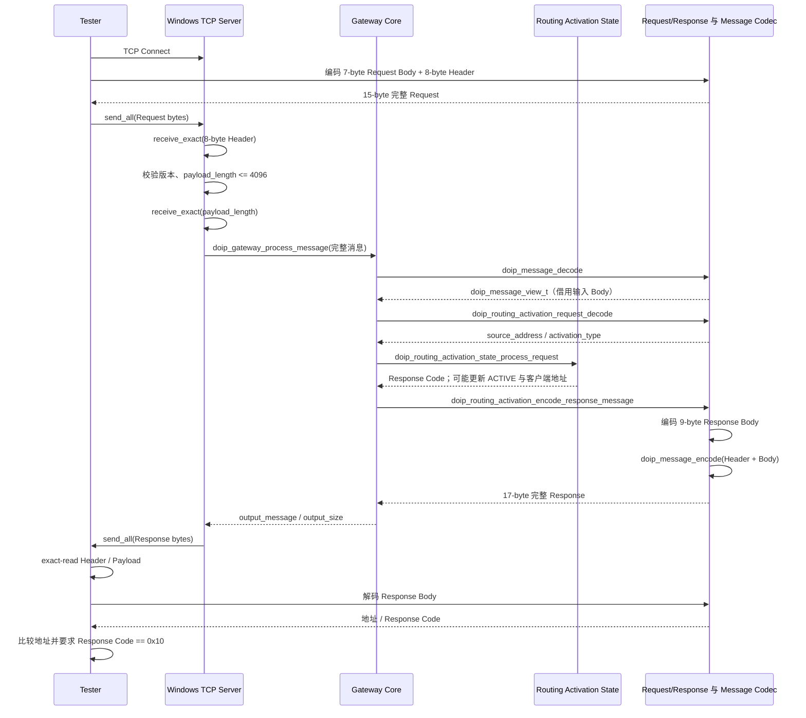

# 04 Routing Activation 实现

## 学习目标

能够追踪 Request 从完整消息解码到状态更新、Response 编码的调用过程，并能解释 TCP 连接与逻辑路由激活状态并非同一件事。

## 交互目的与项目边界

在 DoIP 诊断场景中，Routing Activation 用于在后续诊断通信前请求 Gateway 建立相应逻辑路由上下文。真实系统还会涉及更多状态、授权/策略与失败响应语义。本项目只模拟最基本的请求、响应和一份客户端状态；没有 ECU 转发。

## 数据结构与实现规则

- `doip_routing_activation_request_t`：`source_address`（16 位）、`activation_type`（8 位）。
- `doip_routing_activation_response_t`：客户端地址、Entity 地址、Response Code。
- `doip_routing_activation_context_t`：`INACTIVE` / `ACTIVE` 与一个 `client_logical_address`。
- `doip_gateway_t`：上述上下文、Entity 地址、显式配置的冲突码。

`doip_routing_activation_state_process_request` 的实际决策：

| 当前状态 | Request 地址 | 结果 | 状态副作用 |
|---|---|---|---|
| INACTIVE | 任意 16 位地址 | `DOIP_RESULT_OK`，Response Code `0x10` | 保存地址，切换 ACTIVE。 |
| ACTIVE | 与保存地址相同 | `DOIP_RESULT_OK`，`0x10` | 保持原状态。 |
| ACTIVE | 地址不同 | `DOIP_RESULT_OK`，返回调用者传入的冲突码（Server 默认 `0x03`） | 不替换保存的地址。 |
| 枚举值非法 | 任意 | `DOIP_RESULT_INVALID_ARGUMENT` | 状态内容不变；Response Code 输出初始化为 0。 |

状态模块不检查 `activation_type`，也不验证 Logical Address 范围。请求仅在固定 Body Codec 检查 Reserved 与长度。

## Gateway 请求处理步骤

`doip_gateway_process_message` 接受完整输入报文及其精确长度、输出报文缓冲区/容量与 `output_size`：

1. 若 `output_size` 非空，先置零；必要指针为空时返回 `INVALID_ARGUMENT`。
2. `doip_message_decode` 校验 Generic Header 和整条消息长度。
3. 若 Payload Type 不是 `DOIP_PAYLOAD_TYPE_ROUTING_ACTIVATION_REQUEST`，返回 `UNSUPPORTED`。
4. `doip_routing_activation_request_decode` 解析 7 字节请求体。
5. 确认输出容量至少为 `8 + 9 = 17` 字节，**在状态处理前**检查；空间不足返回 `BUFFER_TOO_SMALL`，不激活状态。
6. 调用 `doip_routing_activation_state_process_request` 得到 Response Code 并可能更新上下文。
7. 设置 Entity 地址与响应码，调用 `doip_routing_activation_encode_response_message` 输出完整 Response。

前置验证失败、Payload Type 不支持和输出容量不足都不改变 Routing Activation 状态。输入与输出报文内存允许重叠，因为函数先把完整消息和 Request 解码到视图/局部结构后才输出；它们不能与 `gateway` 状态对象重叠。对成功状态处理后的响应编码，当前使用固定合法结构和已预检容量。

## Response 生成链

`doip_routing_activation_encode_response_message`：

1. 检查参数并将 `*output_size` 清零。
2. 检查至少 17 字节输出容量。
3. 将 Request `source_address` 作为 response client 地址，将参数中的 Entity 地址和 Response Code 写入局部 `doip_routing_activation_response_t`。
4. Response Body Codec 生成 9 字节载荷（含四个 Reserved 零）。
5. 填充版本 `02 FD`、类型 `0x0006`、长度 9 的 `doip_header_t`。
6. `doip_message_encode` 输出 8+9 字节，并令 `*output_size = 17`。

`doip_routing_activation_process_request_message` 是不含状态机的便捷入口：解码单条完整 Request，检查类型和 Body，然后委托上面的 Response 组装函数。Server 的 Gateway 主链走 `doip_gateway_process_message`，从而包含状态处理。

## 时序图

## Routing Activation 与 TCP Connection 的区别

TCP Connect 只建立传输连接，不会自动调用状态处理函数，也不代表 DoIP 路由激活成功。需收到完整、可解码的 Request 并通过 Gateway 状态处理，才会生成 Response。Tester 通过验证响应码 `0x10` 和地址匹配，才将此次测试视为成功。

Server 当前是同步、单客户端处理：在当前客户端断开或协议错误后关闭 client socket，并调用 `doip_gateway_reset_routing_activation` 清除激活上下文；然后返回 accept 循环继续接客户端。这是一种教学实现中的连接生命周期策略，不代表所有 DoIP 实现的状态规则。

## 成功、拒绝及失败路径

- **状态成功**：空闲首请求或同地址重复请求，响应码 `0x10`。
- **业务冲突响应**：活动状态遇到不同逻辑地址，响应码为配置值；`state_process_request` 本身返回 `OK`，Gateway 仍编码一个 Response。Tester 会把任何非 `0x10` 响应视为失败。
- **消息层失败**：头部无效、长度错误、非 Request Payload Type、Body 格式错误、参数空指针等，返回相应 `doip_result_t`，不生成正常响应。
- **输出空间不足**：Gateway 在状态更新前失败，不改变状态。
- **网络断开/协议拒绝**：Server 关闭客户端连接；无论该连接此前是否已激活，服务端在该客户端处理结束时重置 Gateway Routing Activation。

## 相关测试

- `test_doip_routing_activation_state.c`：首激活、同客户端重试、冲突客户端不覆盖、参数错误、Reset/重新激活、非法枚举状态。
- `test_doip_routing_activation.c`：成功/拒绝响应、消息类型/长度/Body 错误、输入输出重叠和容量检查。
- `test_doip_gateway.c`：首激活、重复和冲突请求、非法消息不改变状态/输出、容量检查先于状态改变、重置后新地址可激活。
- Windows `test_doip_tcp_server.c` 与 `test_doip_tester.c`：端到端握手和连接生命周期相关路径。

这些测试文件表明测试用例已编写并由 CMake 注册；本次文档编写没有运行测试，不能据此宣称测试在当前机器执行通过。

## 面试时需要能够讲清楚的问题

- 状态上下文保存的是 TCP socket 身份还是 Logical Address？为何？
- TCP Connect 成功但 Routing Activation Response 是 `0x03` 时，Tester 如何处理？
- 为什么 Gateway 要在更新状态之前检查 Response 输出容量？
- 重复同地址请求为何幂等成功？不同地址为何不覆盖？
- Activation Type 目前具体在哪一层被验证或忽略？
- Server 连接断开后状态如何重置？这对连续客户端有什么影响？

## 本章需要掌握的知识点

- TCP Connection 与 Routing Activation 是不同层次、不同事件。
- Gateway 负责完整报文验证和业务调用；State 模块仅执行极简地址策略。
- Request Codec 保存 Activation Type 但 State 不使用它。
- 输出容量检查先于状态副作用；Server 结束客户端时重置该单一上下文。
