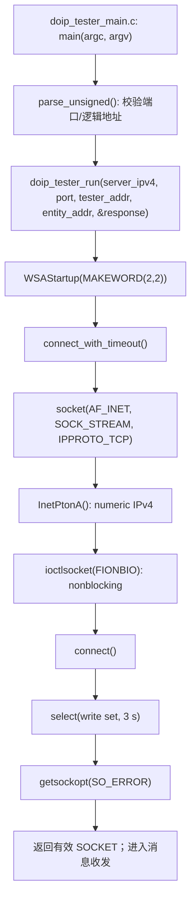
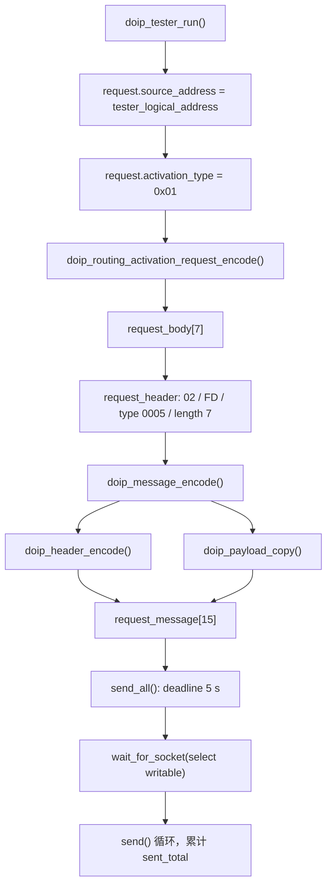
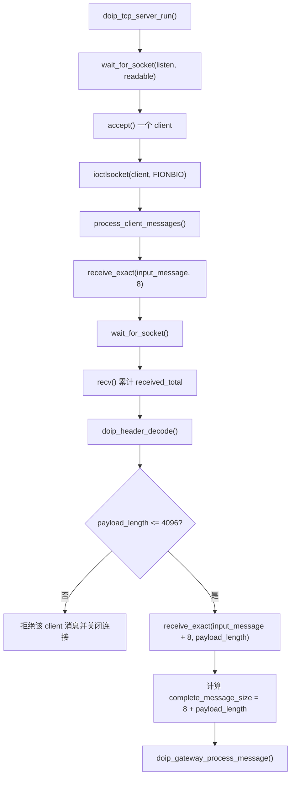
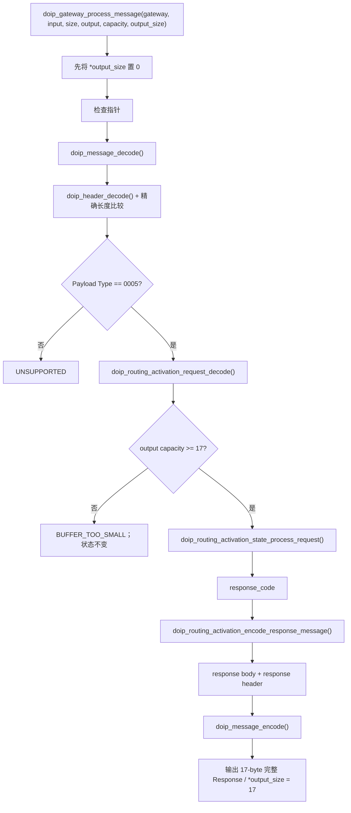
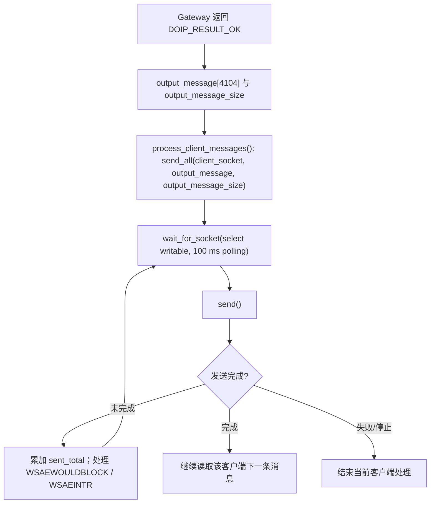
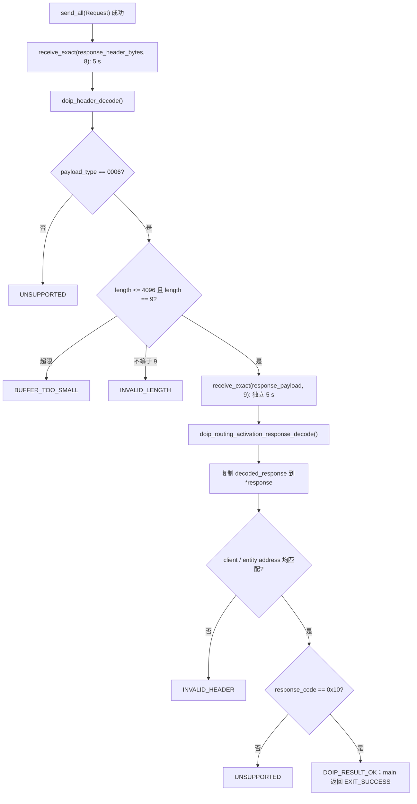

# 07 数据流与函数调用关系

## 学习目标

以真实函数、文件、变量和结构体为线索，独立复述一次 Request/Response 的端到端路径，并能够指出每一层的输入输出和副作用。

## 1. Tester 启动到 TCP 连接建立

依赖文件：`doip_tester_main.c` 的 `main` / `parse_unsigned`，`doip_tester.c` 的 `doip_tester_run` / `connect_with_timeout`。socket 成功仅建立 TCP 连接，不改变 Gateway Routing Activation 状态。

## 2. Tester 发送 Routing Activation Request

关键对象为 `doip_routing_activation_request_t request`、`request_body[7]`、`doip_header_t request_header`、`request_message[15]`。`send_all` 可能多次发送；它只保证字节全部交给 socket 或报告失败。

## 3. Server 收字节并解析 DoIP 消息

这里的第一层 Header 解析是为了确定 TCP 帧的剩余字节数；随后 Gateway 内部 `doip_message_decode` 再对完整消息进行一致性验证并构造 `doip_message_view_t`。这不是重复搬运 Payload：Header 字段确实再次经通用消息 API 解释，但 Payload 视图借用原数组，不复制。

## 4. Gateway Core 处理 Routing Activation

请求字段在 `doip_routing_activation_request_t activation_request`；状态在 `gateway->routing_activation`；返回码先放局部 `response_code`。Gateway 容量校验在状态调用之前，是避免响应空间不足却已提交状态副作用的关键顺序。

## 5. Server 生成并发送 Response

注意 `output_message` 的实际数组是 Server 侧固定缓冲区，`output_message_size` 表示有效的 17 字节，不是数组容量。Response 的字节序列由 Gateway/Codec 已经生成，Server 不再改写。

## 6. Tester 接收并验证 Response

`doip_tester_main.c` 将 `DOIP_RESULT_OK` 映射为 `EXIT_SUCCESS`，其它结果映射为 `EXIT_FAILURE`。错误日志来自 Tester 的 stderr，部分请求/结果信息输出到 stdout。

## 完整实例串联

使用默认配置时：

1. `doip_tester_main.c::main` 取目标 `127.0.0.1:13400`、Tester 地址 `0x0E00`、Entity 地址 `0x1000`。
2. `doip_tester.c::doip_tester_run` 初始化 Winsock 并由 `connect_with_timeout` 建立 TCP 连接。
3. Request Codec 将 `doip_routing_activation_request_t{0x0E00, 0x01}` 转为 `0E 00 01 00 00 00 00`。
4. Message Codec 在前面加 8 字节 `02 FD 00 05 00 00 00 07`，总计 15 字节。
5. Tester `send_all` 完成 15 字节发送；TCP 可能分段传输，协议不依赖分段。
6. `doip_tcp_server.c::doip_tcp_server_run` 接受连接，`process_client_messages` 先 `receive_exact` 收 8 字节，再以长度 7 收 Body。
7. `doip_header_decode` 提取版本、类型和长度；`process_client_messages` 先确保 `7 <= 4096`。
8. `doip_gateway.c::doip_gateway_process_message` 解完整消息，再由 Request Codec 提取 `source_address = 0x0E00`。
9. `doip_routing_activation_state_process_request` 若上下文 INACTIVE，则记录地址、设 ACTIVE 并输出 `0x10`。
10. `doip_routing_activation_encode_response_message` 构造 9 字节 Body `0E 00 10 00 10 00 00 00 00`，再与 Response Header 合成为 17 字节。
11. Server `send_all` 把这 17 字节写回 TCP。
12. Tester 分阶段精确读取 Header/Body，校验 `0x0006`、长度 9、两个地址及成功码 `0x10`，然后返回成功。

若活动状态收到另一个逻辑地址，步骤 9 改为保留原状态并输出配置冲突码；Gateway 仍可编码 Response，但 Tester 将其判为非成功。

## 面试时需要能够讲清楚的问题

- 为什么 TCP Server 和 Gateway 都出现 Header Decoder？二者分别解决什么问题？
- 从 `request_body` 到 wire bytes，按调用顺序经过哪些函数？
- 哪个对象保存激活地址？该地址何时更新、何时清除？
- Tester 读取 Response 时何时知道 Body 长度？为什么要先校验上限？
- 哪些变量是借用指针，哪些是拥有实际字节的缓冲区？
- 若输出容量不足，调用链在哪一步停止，状态是否变化？

## 本章需要掌握的知识点

- 能从命令行入口追到 socket 建立、请求编码、分帧、Gateway、状态、响应编码和验证。
- TCP Server 的 framing 解码与 Gateway 完整消息校验各有边界职责。
- `input_message`/`output_message` 是固定缓冲区，Message View 的 Payload 指针借用输入。
- 成功判定最终发生在 Tester：地址匹配且 Response Code 等于 `0x10`。
