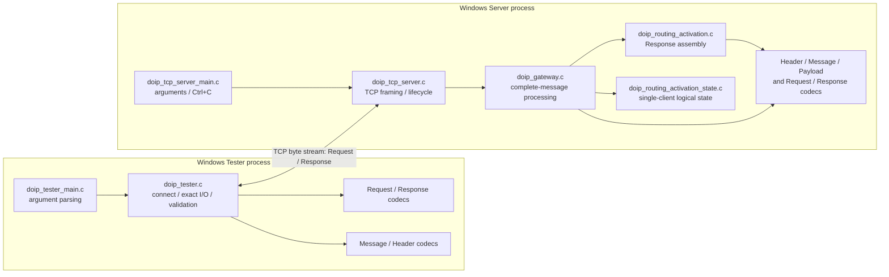

# 01 System Architecture

## Learning Objectives

Understand the boundary between the Protocol Core and Windows Transport Layer, and explain dependencies, data ownership, and architectural limitations using actual source files and structures.

## Architecture Diagram

The diagram shows only modules and dependencies present in the source. The Tester and Server run as separate processes and exchange encoded messages over TCP. The Gateway and Routing Activation State are owned by the Server process through `doip_tcp_server_t`.

`doip_payload_type.h` contains constants only; it is not a parser. There are no ECU, UDP Discovery, diagnostic-forwarding, or OEM-extension processing modules in the current source.

## Protocol Core and Transport Layer

### Protocol Core

The protocol modules do not create sockets. They convert between in-memory fields and wire bytes, validate complete messages, and apply the simplified activation state:

- `doip_types.h`: shared `doip_result_t` error enum.
- `doip_header.c`: Generic Header encoding and decoding.
- `doip_payload.c`: payload-length checks and byte copying.
- `doip_message.c`: combines Header and Payload Body, or returns a message view that borrows the input memory.
- `doip_routing_activation_request.c` / `doip_routing_activation_response.c`: codecs for the basic fixed-size bodies.
- `doip_routing_activation.c`: constructs a complete Routing Activation Response; also provides a convenience entry point that processes a raw Request message and delegates response construction.
- `doip_routing_activation_state.c`: one simplified client-state context.
- `doip_gateway.c`: dispatches a complete input message, applies the state policy, and invokes response construction.

### Windows TCP Transport

- `doip_tcp_server.c` owns Winsock initialization, listening/client sockets, accept, initial Generic Header reads, the Payload Length limit, exact receive/send loops, connection cleanup, and state reset.
- `doip_tester.c` owns the client socket, connection timeout, request transmission, and response reception/validation.
- `doip_tcp_server_main.c` and `doip_tester_main.c` provide command-line handling and process entry points.

The Server passes a complete encoded message to the Gateway; the Gateway knows nothing about sockets or TCP segmentation. In the reverse direction, the Gateway returns a complete encoded response, and the Server sends it using a loop.

## Responsibilities of the Main Source Files

| File | Responsibility and key entry points |
|---|---|
| `c-core/src/doip_header.c` | `doip_header_encode/decode`: big-endian handling of the 8-byte Header; accepts only the project’s configured version. |
| `c-core/src/doip_payload.c` | `doip_payload_check_length` compares lengths; `doip_payload_copy` copies bytes after checking capacity. |
| `c-core/src/doip_message.c` | `doip_message_encode` creates a complete message; `doip_message_decode` decodes exactly one message and borrows its payload bytes. |
| `c-core/src/doip_routing_activation_request.c` | Encodes/decodes the 7-byte Request Body; Reserved bytes must be zero. |
| `c-core/src/doip_routing_activation_response.c` | Encodes/decodes the 9-byte Response Body; preserves the Response Code and requires zero Reserved bytes. |
| `c-core/src/doip_routing_activation_state.c` | Reset, first activation, same-address retry, different-address conflict, and state query. |
| `c-core/src/doip_routing_activation.c` | Builds the 9-byte Response Body, Response Header, and complete Response; convenience entry point decodes then delegates. |
| `c-core/src/doip_gateway.c` | Validates complete messages, accepts only the Request Payload Type, checks output capacity, updates state, and builds the complete Response. |
| `c-core/src/doip_tcp_server.c` | Windows TCP server and nonblocking I/O helpers. |
| `c-core/src/doip_tcp_server_main.c` | Server defaults, command-line parsing, and console stop handler. |
| `c-core/src/doip_tester.c` | Windows TCP client and Response validation. |
| `c-core/src/doip_tester_main.c` | Tester argument parsing and process exit-code mapping. |

## Main Data Structures

| Structure | Purpose of its members |
|---|---|
| `doip_header_t` | In-memory values for `protocol_version`, `inverse_protocol_version`, `payload_type`, and `payload_length`; it is not a wire Header that can be copied directly with `memcpy`. |
| `doip_message_view_t` | Decoded `header` plus a `payload` pointer into the input buffer; it does not own or copy the Body. |
| `doip_routing_activation_request_t` | `source_address` and `activation_type`; the Reserved bytes in the 7-byte wire Body have no structure members. |
| `doip_routing_activation_response_t` | Client logical address, DoIP Entity logical address, and Response Code. |
| `doip_routing_activation_context_t` | `state` and one `client_logical_address` while active. |
| `doip_gateway_t` | Routing Activation context, Entity address, and explicitly configured conflict response code. |
| `doip_tcp_server_t` | IPv4/port configuration, socket handles, stop/lifecycle fields, Winsock state, last socket error, and Gateway instance. |

## Data Transfer and Ownership

1. The Tester encodes logical fields into a stack-allocated Request Body, then the Message Codec builds a 15-byte complete Request.
2. `send_all` may pass the message to Winsock in multiple `send()` calls; TCP does not preserve application message boundaries.
3. The Server reads the 8-byte Header into `input_message`, then reads the Body into the same buffer according to `payload_length`.
4. `doip_gateway_process_message` calls `doip_message_decode`; `doip_message_view_t.payload` points into the original buffer. The Request Codec decodes fields into a separate small structure.
5. The Gateway stores the address/state in `doip_routing_activation_context_t` and constructs a Response using local parameters and a payload buffer.
6. Response bytes are written to the Server-provided `output_message`; the Server sends them in a loop.

The Gateway API explicitly permits the Request and Response message regions to overlap because the complete Request is decoded before output is written. This is not a general overlap guarantee for the source/destination regions of `doip_message_encode` or for a Response structure and its destination buffer. The lifetime of `doip_message_view_t.payload` is bounded by the input buffer’s lifetime.

## Observed Design Characteristics, Benefits, and Limits

**Observable in the source:** the Gateway receives complete messages rather than sockets, so ordinary unit tests can call it directly; TCP framing is concentrated in the Windows Server; the Tester and Gateway reuse Header, Message, and body codecs.

Benefits include separation of protocol serialization from Winsock, reviewable fixed buffers with explicit capacities, and tests at both module and network-integration levels. Limitations include the lack of an incremental stream decoder, a single-client state model, Windows-only Transport and Tester, and no ECU adapter or extensible routing table.

Possible future improvements—not current features—include a cross-platform Transport adapter, concurrent connections with per-connection state, a reusable incremental frame decoder, configurable routing/authorization policies, Diagnostic Message and ECU-backend modules, and corresponding tests.

## Key Source Entry Points

Line numbers below refer to function starts in the repository as inspected for this guide.

| Code location | Entry point |
|---|---|
| [`doip_header.c:12`](../../../c-core/src/doip_header.c#L12), [`doip_header.c:42`](../../../c-core/src/doip_header.c#L42) | Header encoding/decoding. |
| [`doip_payload.c:3`](../../../c-core/src/doip_payload.c#L3), [`doip_payload.c:14`](../../../c-core/src/doip_payload.c#L14) | Payload-length check/copy. |
| [`doip_message.c:5`](../../../c-core/src/doip_message.c#L5), [`doip_message.c:50`](../../../c-core/src/doip_message.c#L50) | Complete Message encoding/decoding. |
| [`doip_routing_activation_request.c:3`](../../../c-core/src/doip_routing_activation_request.c#L3), [`doip_routing_activation_request.c:27`](../../../c-core/src/doip_routing_activation_request.c#L27) | Request Body codec. |
| [`doip_routing_activation_response.c:3`](../../../c-core/src/doip_routing_activation_response.c#L3), [`doip_routing_activation_response.c:29`](../../../c-core/src/doip_routing_activation_response.c#L29) | Response Body codec. |
| [`doip_routing_activation_state.c:3`](../../../c-core/src/doip_routing_activation_state.c#L3), [`doip_routing_activation_state.c:16`](../../../c-core/src/doip_routing_activation_state.c#L16) | State reset/request processing. |
| [`doip_routing_activation.c:12`](../../../c-core/src/doip_routing_activation.c#L12), [`doip_routing_activation.c:71`](../../../c-core/src/doip_routing_activation.c#L71) | Response-message construction/convenience processing entry point. |
| [`doip_gateway.c:44`](../../../c-core/src/doip_gateway.c#L44) | Complete-message Gateway processing. |
| [`doip_tcp_server.c:99`](../../../c-core/src/doip_tcp_server.c#L99), [`doip_tcp_server.c:142`](../../../c-core/src/doip_tcp_server.c#L142), [`doip_tcp_server.c:182`](../../../c-core/src/doip_tcp_server.c#L182) | Server exact receive, send-all, and client-message loop. |
| [`doip_tcp_server.c:299`](../../../c-core/src/doip_tcp_server.c#L299), [`doip_tcp_server.c:403`](../../../c-core/src/doip_tcp_server.c#L403) | Server start and run loop. |
| [`doip_tester.c:145`](../../../c-core/src/doip_tester.c#L145), [`doip_tester.c:234`](../../../c-core/src/doip_tester.c#L234) | Tester connection and complete test flow. |
| [`doip_tcp_server_main.c:47`](../../../c-core/src/doip_tcp_server_main.c#L47), [`doip_tester_main.c:27`](../../../c-core/src/doip_tester_main.c#L27) | The two executable `main` functions. |

## Questions You Should Be Able to Answer

- Why does the Gateway not use sockets directly, and how does the Server ensure a complete message is passed to it?
- Does `doip_message_view_t` copy the Payload? When does its pointer become invalid?
- Which shared codecs are used by both the Tester and Gateway?
- Why do Vehicle Identification constants not prove that discovery is implemented?
- Why can’t the current single-address Gateway state simply be reused for concurrent clients?

## Key Takeaways

- The Gateway accepts and returns **complete encoded DoIP messages**; TCP segmentation is handled by the Server and Tester.
- The Message View borrows input memory instead of copying the Body.
- Routing Activation state belongs to a Gateway instance, not to a TCP protocol field.
- The current source has no ECU, UDP, diagnostic forwarding, or concurrent-client module.
