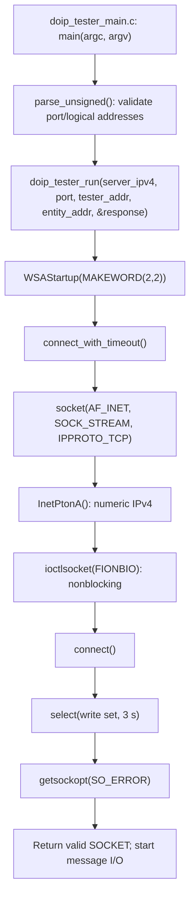
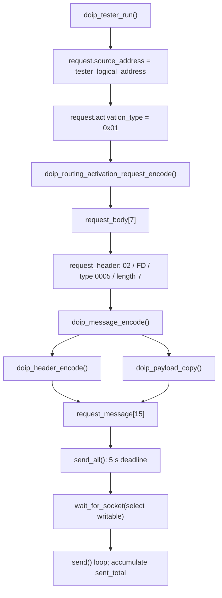
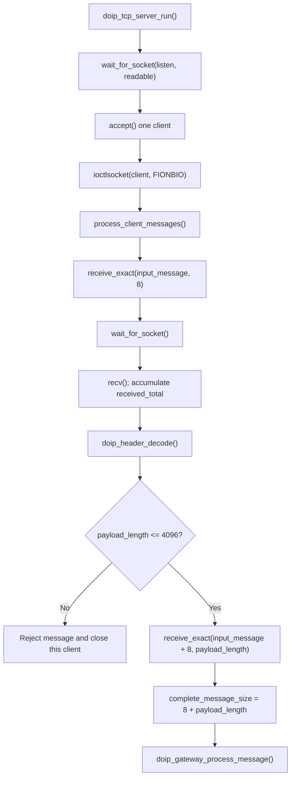
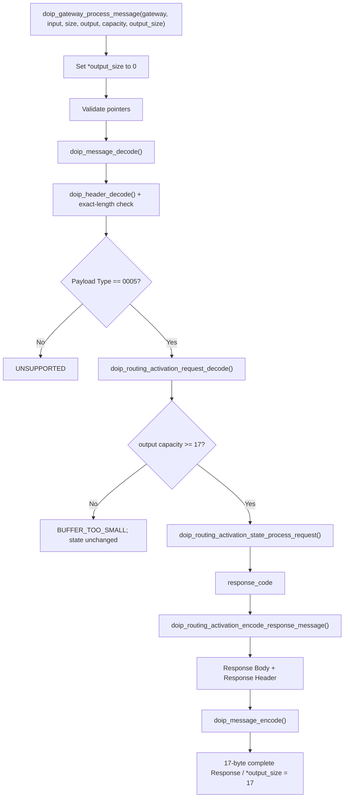
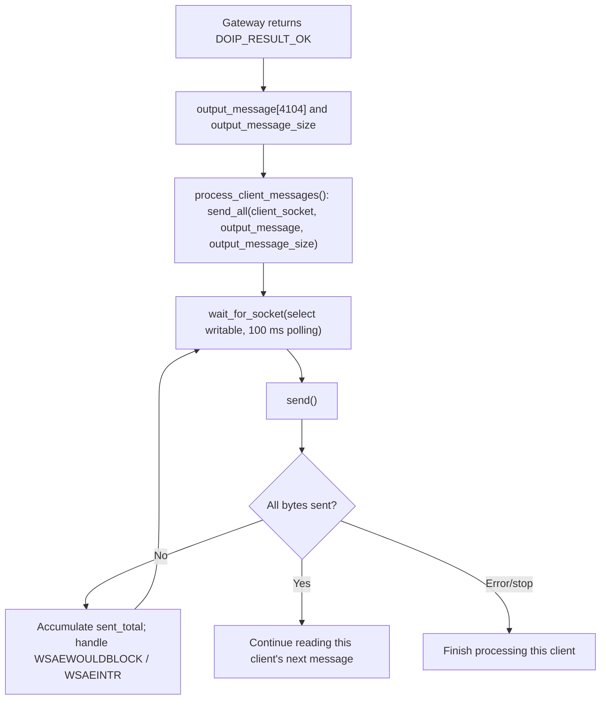
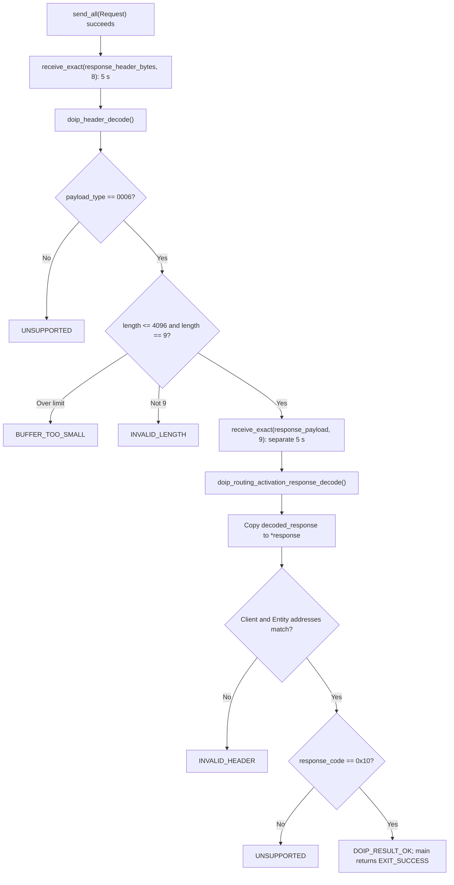

# 07 Data Flow and Function Call Chains

## Learning Objectives

Use real functions, files, variables, and structures to explain one end-to-end Request/Response exchange. Identify each layer’s input/output and side effects.

## 1. Tester Startup Through TCP Connection

Files/functions: `doip_tester_main.c::main` / `parse_unsigned`, then `doip_tester.c::doip_tester_run` / `connect_with_timeout`. A successful socket connection does not change Gateway Routing Activation state.

## 2. Tester Sends a Routing Activation Request

Key objects are `doip_routing_activation_request_t request`, `request_body[7]`, `doip_header_t request_header`, and `request_message[15]`. `send_all` may call `send()` more than once; it either sends every byte or reports failure.

## 3. Server Receives TCP Bytes and Parses a DoIP Message

The first Header parse is needed to determine how many more TCP bytes to read. Inside the Gateway, `doip_message_decode` validates the complete message and creates a `doip_message_view_t`. This is not a second Payload copy: the Header is parsed again by the generic message API, but the Payload view borrows the original array.

## 4. Gateway Core Processes Routing Activation

The decoded fields are held in `doip_routing_activation_request_t activation_request`; state is stored in `gateway->routing_activation`; the response code first resides in local variable `response_code`. Checking capacity before calling the State function prevents an activation side effect when no Response can be written.

## 5. Server Builds and Sends the Response

`output_message` is the Server’s fixed-size array; `output_message_size` is the number of valid Response bytes (17), not the array capacity. The Gateway/Codec has already created the Response bytes; the Server does not rewrite them.

## 6. Tester Receives and Validates the Response

`doip_tester_main.c` maps `DOIP_RESULT_OK` to `EXIT_SUCCESS` and every other result to `EXIT_FAILURE`. Error messages are written to stderr; some progress and response information is written to stdout.

## End-to-End Example

With the default configuration:

1. `doip_tester_main.c::main` uses destination `127.0.0.1:13400`, Tester address `0x0E00`, and Entity address `0x1000`.
2. `doip_tester.c::doip_tester_run` initializes Winsock and establishes TCP using `connect_with_timeout`.
3. The Request Codec converts `doip_routing_activation_request_t{0x0E00, 0x01}` to `0E 00 01 00 00 00 00`.
4. The Message Codec prepends Header `02 FD 00 05 00 00 00 07`, producing 15 bytes.
5. Tester `send_all` sends the 15 bytes; TCP may segment them, and the protocol does not depend on segment boundaries.
6. `doip_tcp_server.c::doip_tcp_server_run` accepts the connection. `process_client_messages` reads 8 Header bytes, then 7 Body bytes.
7. `doip_header_decode` extracts version, type, and length; `process_client_messages` first checks `7 <= 4096`.
8. `doip_gateway.c::doip_gateway_process_message` decodes the complete message; the Request Codec extracts `source_address = 0x0E00`.
9. If the state is INACTIVE, `doip_routing_activation_state_process_request` saves the address, sets ACTIVE, and returns `0x10`.
10. `doip_routing_activation_encode_response_message` creates Body `0E 00 10 00 10 00 00 00 00`, then the Response Header, for 17 bytes total.
11. Server `send_all` writes these 17 bytes back over TCP.
12. Tester exact-reads Header and Body, checks type `0x0006`, length 9, both addresses, and success code `0x10`, then returns success.

If a different address arrives while the state is active, step 9 instead preserves the existing state and returns the configured conflict code. The Gateway can still encode a Response, but the Tester reports the exchange as unsuccessful.

## Questions You Should Be Able to Answer

- Why does the Header Decoder appear in both the TCP Server path and Gateway path?
- In what order do calls transform `request_body` into wire bytes?
- Which object stores the active address, and when is it updated or cleared?
- How does the Tester learn the Response Body length, and why check its upper bound first?
- Which pointers are borrowed views and which variables own byte arrays?
- Where does the call chain stop on insufficient output capacity, and does state change?

## Key Takeaways

- You should be able to trace from command-line entry through sockets, encoding, framing, Gateway state, Response generation, and validation.
- The Server’s framing parse and the Gateway’s complete-message validation have separate responsibilities.
- `input_message` and `output_message` are fixed buffers; a Message View borrows input memory.
- Final success is decided by the Tester: matching addresses and Response Code `0x10`.
